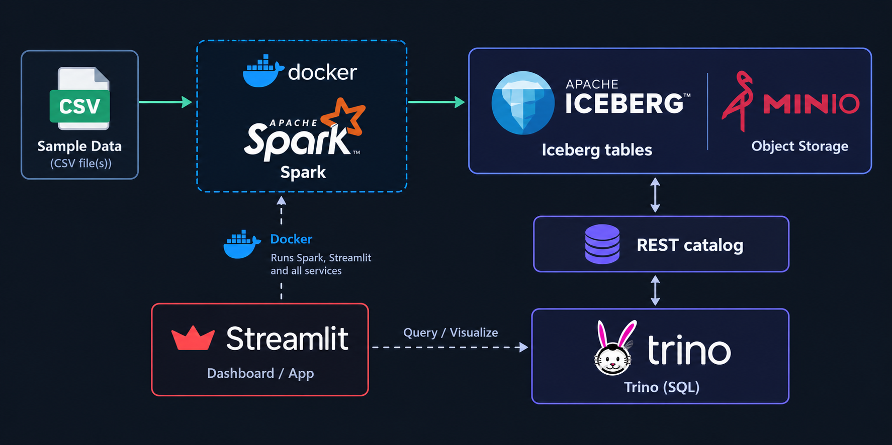

A containerized local data lakehouse built to demonstrate modern data engineering patterns: **Apache Spark**, **Apache Iceberg**, **MinIO (S3-compatible object storage)**, an **Iceberg REST catalog**, **Trino**, and a **Streamlit dashboard**. Docker Compose runs the services locally, while Spark builds the medallion tables and Trino provides the SQL query layer.

The project goes beyond a basic CSV-to-table demo: it includes multiple source formats, data-quality checks, analytics tables, inventory event processing, Iceberg snapshots and time travel, governance metadata, and a dashboard for exploring pipeline outputs.

## Architecture



### Main components

| Component | Responsibility |
| --- | --- |
| **Docker Compose** | Runs the local services and provides their network. |
| **Apache Spark** | Ingests and transforms source data, then writes Iceberg tables. |
| **Apache Iceberg** | Provides table metadata, snapshots, schema/table evolution capabilities, and ACID table operations. |
| **MinIO** | Stores Iceberg data files and metadata in S3-compatible object storage. |
| **Iceberg REST catalog** | Coordinates table metadata and table access for Spark and Trino. |
| **Trino** | Queries the lakehouse tables with SQL. |
| **Streamlit** | Displays business metrics, inventory, data-quality results, and recent snapshot information using Trino queries. |

## Medallion data model

The bootstrap pipeline builds bronze, silver, and gold layers.

| Layer | Table | Purpose |
| --- | --- | --- |
| Bronze | `bronze.orders_raw` | Raw order data as ingested from CSV. |
| Silver | `silver.orders` | Typed and cleaned order data, with null records removed. |
| Gold | `gold.daily_revenue` | Revenue by day and region. |
| Gold | `gold.monthly_revenue` | Revenue, order count, and customer metrics by month and region. |
| Gold | `gold.product_performance` | Product revenue and order metrics by region. |
| Gold | `gold.data_quality_summary` | Missing or invalid record checks by dataset. |
| Gold | `gold.pipeline_monitoring` | Data freshness and issue load by pipeline stage. |
| Gold | `gold.data_governance_summary` | Table ownership, lineage, and business definitions. |
| Gold | `gold.inventory_availability` | Current stock levels and availability by warehouse. |

## Multiple source formats and inventory processing

The pipeline ingests CSV sources and JSON Lines inventory-adjustment events, normalizes them into Iceberg tables, and stores the underlying Iceberg data files as Parquet.

During bootstrap, Spark:

1. Loads the opening inventory and adjustment events.
2. Keeps the event ledger in `silver.inventory_adjustments`.
3. Aggregates pending deltas by inventory item.
4. Applies one row per item using an Iceberg `MERGE`.
5. Uses the maximum event ID as a replay watermark.

The bootstrap rebuilds from opening stock before applying the complete event ledger, so repeated runs produce the same final inventory for the sample data. Each successful merge is committed as a new Iceberg snapshot.

Input files:

- `sample-data/orders.csv`
- `sample-data/inventory.csv`
- `sample-data/inventory_adjustments.jsonl`
- `sample-data/inventory_adjustments_round2.jsonl`

After bootstrap, expected inventory quantities are:

| Inventory ID | Expected quantity |
| --- | ---: |
| `10001` | `124` |
| `10002` | `42` |
| `10003` | `12` |
| `10004` | `15` |

The reconciliation query in `sql/examples.sql` compares opening stock plus all event deltas with the current Silver quantity. Each row should report `match`.

## Data governance and lineage

`gold.data_governance_summary` provides a straightforward map from source data to business-ready reporting. It lists each table, dataset, layer, owner, business name, and lineage description.

Ownership follows the layer's responsibility:

- **Bronze:** owned by the team providing the raw source feed.
- **Silver:** owned by the team defining the cleaned business model.
- **Gold:** owned by analytics or data engineering, depending on the downstream use case.

## Iceberg ACID transactions, snapshots, and time travel

The inventory merge demonstrates Iceberg's table-level transaction behavior:

- **Atomicity:** the merge is committed as a table snapshot rather than as partially visible row writes.
- **Consistency:** typed quantities and the event-ID guard preserve the sample inventory update rules.
- **Isolation:** readers query a consistent snapshot while a write is committed.
- **Durability:** committed data and Iceberg metadata are stored in MinIO.

Inspect current inventory and recent snapshots in Trino:

```sql
SELECT *
FROM gold.inventory_availability
ORDER BY warehouse, product_id;

SELECT committed_at, snapshot_id, parent_id, operation
FROM silver."inventory$snapshots"
ORDER BY committed_at DESC;
```

To query an earlier table version, replace the example snapshot ID with a real ID from the snapshot history:

```sql
SELECT *
FROM silver.inventory FOR VERSION AS OF 1234567890123456789
ORDER BY inventory_id;
```

You can inspect recent snapshots, table history, and data files for `gold.daily_revenue` with:

```bash
make iceberg-history
```

The example SQL is in `sql/iceberg_operations.sql`. The version query is commented out until you replace its sample ID with a real snapshot ID. Snapshot rollback and expiration are intentionally left as explicit operator actions.

## Prerequisites

- Docker Engine
- Docker Compose v2 (or the legacy `docker-compose` binary)
- Approximately 6 GB of free RAM for Spark and Trino

On Ubuntu, if Docker is not installed:

```bash
sudo apt update
sudo apt install -y docker.io docker-compose-v2
sudo usermod -aG docker "$USER"
```

Log out and back in after adding your user to the `docker` group.

## Start the lakehouse

From the project root:

```bash
cp .env.example .env   # Optional; defaults already match Compose
docker compose up -d
```

If your system uses the legacy Compose binary, use `docker-compose` instead of `docker compose`.

Check that the services are running:

```bash
docker compose ps
```

Load the sample data and build the tables:

```bash
make bootstrap
```

Alternatively, run the bootstrap script directly:

```bash
docker compose exec spark python /home/iceberg/jobs/bootstrap.py
```

## Streamlit dashboard

Start the dashboard with:

```bash
make dashboard
```

Open [http://localhost:8501](http://localhost:8501).

The dashboard queries Trino over the Docker Compose network and displays:

- Revenue and order KPIs
- Inventory availability by warehouse
- Data-quality issues
- Recent Iceberg inventory snapshots

Use **Refresh live data** to bypass the 15-second cache. Streamlit and the Trino Python client are installed in the dashboard image.

## Query with Trino

Trino's web UI is available at [http://localhost:8088](http://localhost:8088) (no authentication configured for this local setup).

Open the Trino CLI:

```bash
docker compose exec trino trino --catalog iceberg
```

Then run SQL:

```sql
SHOW SCHEMAS;

SELECT *
FROM gold.daily_revenue
ORDER BY order_date, region;
```

Run the project's example query target:

```bash
make query
```

## Other service endpoints

| Service | URL / command |
| --- | --- |
| Trino UI | [http://localhost:8088](http://localhost:8088) |
| Streamlit dashboard | [http://localhost:8501](http://localhost:8501) |
| Spark UI | [http://localhost:8080](http://localhost:8080) |
| Jupyter in the Spark image | [http://localhost:8888](http://localhost:8888) |
| MinIO console | [http://localhost:9001](http://localhost:9001) |
| Iceberg REST catalog | [http://localhost:8181](http://localhost:8181) |
| Spark SQL shell | `docker compose exec spark spark-sql` |

The MinIO console uses the local default credentials `minioadmin` / `minioadmin`. These credentials are for local development only; do not reuse them outside this machine.

## Orchestration definition

The repository includes an Airflow-style DAG definition for a daily lakehouse refresh workflow. Its current sequence is:

1. `bootstrap_lakehouse`
2. `quality_check`
3. `analytics_snapshot`

Validate the DAG definition with:

```bash
make dag-check
```

This repository includes the DAG definition; the command above validates it and does not, by itself, start an Airflow scheduler.

## Project layout

```text
.
├── docker-compose.yml
├── Makefile
├── README.md
├── .env.example
├── airflow/
│   └── dags/
│       └── lakehouse_daily_pipeline.py
├── spark/
│   ├── conf/
│   │   └── spark-defaults.conf
│   └── jobs/
│       └── bootstrap.py
├── sample-data/
│   ├── orders.csv
│   ├── inventory.csv
│   ├── inventory_adjustments.jsonl
│   └── inventory_adjustments_round2.jsonl
├── trino/
│   └── catalog/
│       └── iceberg.properties
└── sql/
    ├── examples.sql
    └── iceberg_operations.sql
```

## Stop the services

Stop the containers while preserving the MinIO data volume:

```bash
docker compose down
```

To remove the containers **and** the persisted MinIO volume, use:

```bash
docker compose down -v
```

The second command deletes the local warehouse data. Run it only when you want to reset the lakehouse.
'''
